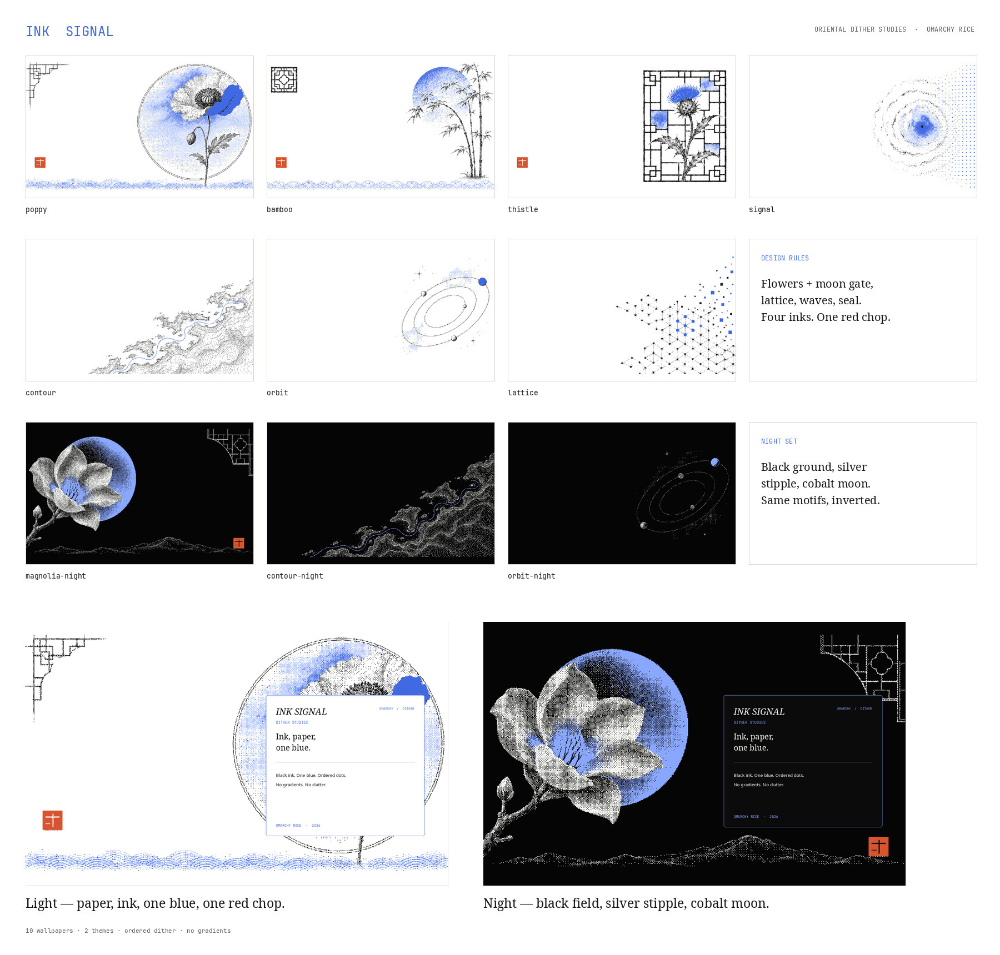
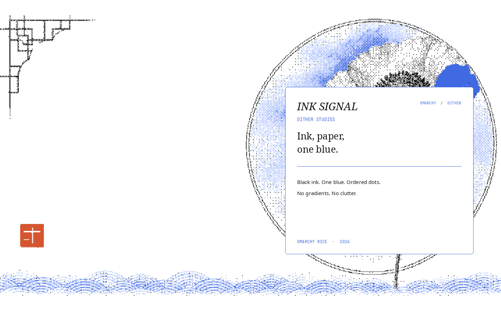
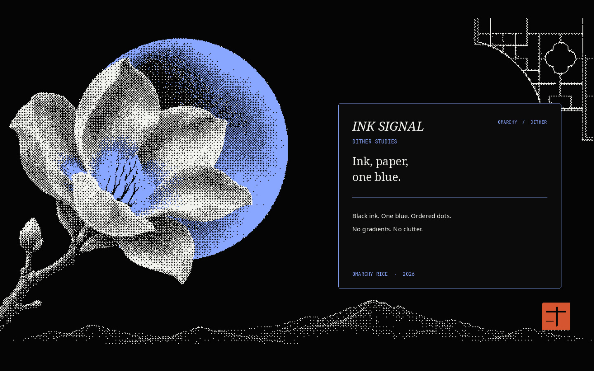

# Ink Signal

**Oriental dither studies for Omarchy.** A white-paper theme, a black-night theme, and ten wallpapers built from black stipple, one royal blue, and a single vermilion chop.



| Light | Night |
| --- | --- |
|  |  |

## What is inside

- **Ink Signal** — white `#ffffff`, ink `#171717`, royal blue `#4169e1`.
- **Ink Signal Night** — black `#050505`, paper `#f2f2ee`, cobalt `#8aa7ff`.
- **7 light wallpapers**: poppy, bamboo, thistle, signal, contour, orbit, lattice.
- **3 night wallpapers**: magnolia-night, contour-night, orbit-night.
- Ordered Bayer 8×8 dither, 4 px cells, no gradients, no photographic texture.
- Optional extras: day/night switch, wallpaper cycle, Obsidian typography, GTK accent, menu entries.

## Install

```bash
git clone https://github.com/Niraven/omarchy-ink-signal.git
cd omarchy-ink-signal
./install.sh --activate --wallpaper poppy
```

That installs both themes, applies **Ink Signal**, and sets **Poppy** as the background. Nothing is installed system-wide and no `sudo` is used.

The repository root is also a directly installable Omarchy light theme:

```bash
omarchy theme install https://github.com/Niraven/omarchy-ink-signal
```

Use the installer if you want both variants, the night wallpapers, typography, and extras.

### Options

| Flag | What it does |
| --- | --- |
| `--theme light\|night\|both` | Install one variant or both. Default: both. |
| `--wallpaper NAME\|random` | Choose the activated theme's background. |
| `--activate` | Apply the theme and background now. |
| `--geometry` | Add hairline Hyprland geometry: gaps 4/8, border 1, radius 4. |
| `--obsidian` | Sync the generated Omarchy theme into Obsidian and select it. |
| `--hermes` | Publish and activate the Omarchy Hermes skin. |
| `--helpers` | Install `ink-signal-cycle` and `ink-signal-day-night` in `~/.local/bin`. |
| `--typography` | Install and enable the Obsidian type snippet; apply the GTK font stack. |
| `--force` | Replace a differing existing theme, after a backup. |
| `--dry-run` | Print the plan without changing anything. |
| `--backup-dir DIR` | Keep backups somewhere else. |

Existing themes are backed up under `~/.local/state/omarchy/theme-backups/` before replacement.

## Wallpaper set

| Light | Night |
| --- | --- |
| `poppy` — poppy in a moon gate, lattice, waves, chop | `magnolia-night` — magnolia, cobalt moon, ridge, chop |
| `bamboo` — bamboo, moon, lattice square, waves | `contour-night` — contour coast and blue current |
| `thistle` — thistle inside a lattice screen | `orbit-night` — stipple orbits and one blue planet |
| `signal` — rings dissolving into pixels | |
| `contour` — imaginary topographic coast | |
| `orbit` — elliptical ink orbits | |
| `lattice` — isometric node lattice | |

Change only the background with **Super + Alt + A → Desktop Style → Wallpapers**, or `omarchy theme bg next`.

## Extras

```bash
# Switch by local hour (07:00–19:00 light, otherwise night)
./extras/day-night.sh auto

# Cycle the current theme's wallpapers
./extras/cycle-wallpaper.sh next
```

- `extras/obsidian-typography.css` — serif headings, mono code, quiet UI.
- `extras/gtk-accent.css` — blue accent/selection override for GTK 3/4.
- `extras/omarchy-menu.jsonc` — optional Ink Signal menu entries.

These are opt-in. The installer does not enable them for you. See [docs/EXTRAS.md](docs/EXTRAS.md).

## Make your own wallpapers

The palette and dither are reusable:

```bash
python3 -m pip install -r tools/requirements.txt
python3 tools/dither.py my-image.jpg wallpapers/my-study.png --mode light
```

Then drop the PNG into `themes/ink-signal/backgrounds/`. The dither is deliberately coarse: 4 px cells, five inks including the chop red. See [docs/CUSTOMIZE.md](docs/CUSTOMIZE.md).

## Typography

**Noto Serif** for display, **Noto Sans** for UI and body, **JetBrainsMono Nerd Font** for code and the bar. The Obsidian snippet and GTK script are included; the terminal stays mono on purpose. See [docs/TYPOGRAPHY.md](docs/TYPOGRAPHY.md).

## Design rules

- **Paper first.** Most of the screen stays empty; the desktop needs room for windows.
- **One hue.** Royal blue carries every accent. Vermilion appears only in the chop.
- **Ordered, not noisy.** A visible Bayer grid, not film grain or error diffusion.
- **Oriental grammar, new subjects.** Moon gate, lattice, seigaiha waves, contour ridges, chop — applied to original poppy, thistle, bamboo, magnolia, and abstract studies.
- **No text in wallpapers.** The only glyphs are abstract chop marks.

More detail: [docs/DESIGN.md](docs/DESIGN.md).

## Uninstall

```bash
./uninstall.sh --theme both
```

It refuses to remove the active theme. Switch to another theme first. Obsidian and Hermes settings are left alone.

## License

- Code and scripts: **MIT** — see [LICENSE](LICENSE).
- Wallpapers and preview images: **CC BY 4.0** — see [LICENSE-ART](LICENSE-ART).

Ink Signal is an independent rice. It is not affiliated with Omarchy, Obsidian, or Hermes.
